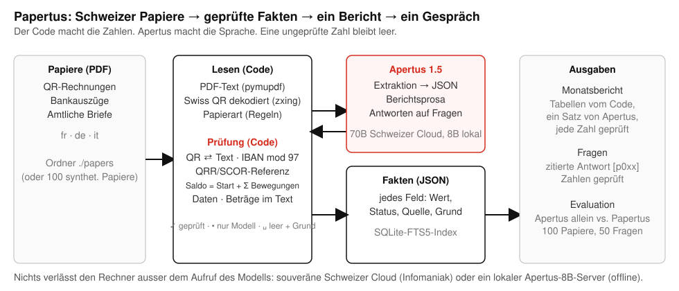

# Technischer Bericht — Papertus

Sprechen Sie mit Ihren eigenen Papieren, auf Ihrem eigenen Laptop, mit einem kleinen Schweizer Modell. Gebaut mit Apertus 1.5.

- **Track:** Track 2B — Papertus
- **Veranstaltung:** Online
- **Team:** Papertus — Igor Jovicic
- **Demo:** https://github.com/igorjovicic/papertus/blob/main/track_2b/docs/papertus-demo.mp4 (1 min 57 s)
- **Repository:** https://github.com/igorjovicic/papertus (`track_2b/`)
- **Dieser Bericht auf Englisch, Französisch und Italienisch:** `docs/Papertus_Report.pdf`, `docs/Papertus_Report.fr.pdf`, `docs/Papertus_Report.it.pdf` (gleicher Inhalt, je eine Sprache)

## 1. Zusammenfassung

Schweizer Verwaltungspapiere tragen ihre eigene Wahrheit in sich: Eine QR-Rechnung kodiert den Betrag, die IBAN und eine Referenz mit Prüfziffer; ein Bankauszug muss aufgehen; ein Brief des Kantons nennt eine Frist in festem Format. Sprachmodelle lesen diese Papiere gut und erfinden trotzdem Zahlen: eine Anzahlung, die vom Total abgezogen wird, eine Rechnungsnummer, die als Zahlungsreferenz genommen wird, ein Schlusssaldo, der « korrigiert » wird, damit er plausibel aussieht. Papertus trennt die beiden Aufgaben. Apertus 1.5 liest die Wörter und schreibt die Sprache; gewöhnlicher Code dekodiert den QR-Code, prüft jede Prüfsumme, rechnet jede Summe nach und vergleicht jedes Datum, so dass jede gezeigte Zahl auf das Papier zurückverweist, aus dem sie stammt, und ein Feld, das der Code nicht bestätigen kann, **leer mit seinem Grund** bleibt, statt zu einer Vermutung zu werden. Aus den geprüften Fakten baut der Code den Monatsbericht auf Französisch, Deutsch, Italienisch oder Englisch mit einem kurzen Absatz von Apertus, dessen jede Zahl geprüft ist, und beantwortet Fragen mit Angabe des Papiers. Der Sinn des Entwurfs ist, dass er mit einem **kleinen Modell auf einem gewöhnlichen Laptop** funktioniert: Das 8B liest, der Code beweist, und nichts verlässt den Rechner. Auf 100 synthetischen Schweizer Papieren mit Ground Truth (40 QR-Rechnungen, 30 Bankauszüge, 30 amtliche Briefe, fr/de/it, mit eingebauten Fallen) erfindet Apertus 1.5 70B allein 4.5 % der Zahlen; Papertus mit demselben 70B erfindet **0.0 %** (100 % korrekt, nichts leer gelassen). Mit Apertus 1.5 8B, lokal auf einem Laptop (8-Bit-Gewichte, kein Internet), erfindet das Modell allein 8.9 % der Zahlen; Papertus mit dem 8B erfindet **0.0 %** (99.3 % korrekt, 0.7 % leer mit Grund), bei etwa zehn Sekunden pro Papier. Das kleine Modell liest; der Code beweist. Ein Container, `make run`, und eine Statuszeile, die sagt, welches es ist: « Apertus 8B · auf diesem Gerät · nichts geht raus ».

## 2. Architektur

Alles läuft in einem einzigen Python-3.12-Container (FastAPI, Port 8640) auf dem Rechner des Benutzers. Datenfluss, von links nach rechts:

1. **Papiere** — PDFs in einem Ablageordner (`./papers`) oder die 100 mitgelieferten synthetischen Papiere.
2. **Lesen (Code)** — Textextraktion mit PyMuPDF; jede Seite wird mit 200 dpi gerendert und mit zxing-cpp nach einem Swiss QR Code abgesucht; die Swiss-QR-Nutzlast (SPC/0200) wird von unserem eigenen Modul `swissqr` geparst; die Papierart wird durch Regeln bestimmt (SPC-Nutzlast → QR-Rechnung; Auszugsvokabular in fr/de/it → Bankauszug; sonst amtlicher Brief), mit einem Modell-Rückfall nur, wenn die Regeln mehrdeutig sind (auf den 100 Papieren nie nötig).
3. **Apertus** — ein Aufruf pro Papier: der Text des Papiers und die Liste der Schlüssel für seine Art, Antwort als JSON, « unbekannt = null, nie eine Vermutung ». Keine Tools, keine Agentenschleife.
4. **Prüfung (Code, `verify.py`)** — die QR-Nutzlast gewinnt gegen das Modell bei Betrag, IBAN, Referenz und Gläubiger; Prüfziffern IBAN mod 97, QRR modulo 10 rekursiv und SCOR (ISO 11649); jeder Betrag muss im Text in einem Schweizer Format vorkommen (`1'234.50`, `1 234.50`, `1234.—`); Daten müssen gültig sein und das Fälligkeitsdatum nach dem Rechnungsdatum liegen; der Anfangssaldo eines Auszugs plus seine Bewegungen muss auf den Rappen dem gedruckten Schlusssaldo entsprechen, und die Summen der Belastungen und Gutschriften müssen der gedruckten Totalzeile des Auszugs entsprechen (ein einzelner Vorzeichenfehler bei genau einer Bewegung wird aus diesen Totalen repariert; zwei Kandidaten → abgelehnt); eine vom Modell abgeschnittene IBAN wird nur dann aus dem Text vervollständigt, wenn die vervollständigte Form mod 97 besteht. Jedes Feld erhält einen Status: **geprüft** (mit seiner Quelle: qr, iban, qrr, text, arithmetic, date), **Modell** (von Apertus gelesen, vom Code nicht beweisbar) oder **leer** (mit der gescheiterten Prüfung als Grund).
5. **Fakten** — JSON pro Papier, nach Dateihash gecacht, in SQLite FTS5 indexiert (keine Vektordatenbank, kein Embedding-Modell).
6. **Ausgaben** — der Monatsbericht (Tabellen vom Code berechnet; ein Absatz von ≤ 80 Wörtern von Apertus aus den Tabellen als JSON, jeder Satz durch `numbers_grounded` geführt, das jeden Satz verwirft, der eine Zahl trägt, die in den Tabellen fehlt) und Fragen (zuerst Regeln für Summen, Salden, Anzahlen und Fristen; sonst gehen die Fakten der sechs besten Papiere an Apertus, das `[p0xx]` zitieren muss; jede Zahl in der Antwort wird gegen die zitierten Fakten geprüft, und eine nicht belegte Antwort wird durch « Ich finde diese Zahl in Ihren Papieren nicht » ersetzt; kein Suchtreffer → kein Modellaufruf).

Die Seite folgt dem Swiss International Style (eine Schrift, ein Raster, Schwarz auf Weiss, ein Rot für das, was bewiesen ist) und nennt in ihrer Kopfzeile, welches Modell antwortet und wo es läuft. Das Evaluationsgeschirr (`eval.py`) lässt dieselbe Pipeline und eine Baseline auf den mitgelieferten Papieren laufen und schreibt `docs/results.md`.

### Zielarchitektur (obligatorisch)

- **b) Air-gapped — die vorgesehene Bereitstellung.** Der Container plus ein Apertus-1.5-8B-Server auf demselben Rechner oder im selben Netz (vLLM oder ein GGUF-Server, beide OpenAI-kompatibel; die Zahlen in § 5 wurden mit den 8-Bit-Gewichten gemessen, lokal auf einem Laptop bereitgestellt). Zur Laufzeit gibt es keinen anderen Netzzugang: kein CDN, keine Schriften, keine Telemetrie, kein Paket-Download. Die Kopfzeile zeigt « Apertus 8B · auf diesem Gerät · nichts geht raus », sobald `LLM_BASE_URL` auf den lokalen Rechner zeigt.
- **c) Souveräne Schweizer Cloud — die Alternative.** Derselbe Container mit `LLM_BASE_URL` auf Apertus 1.5 70B, bereitgestellt von Infomaniak (Genf) über die OpenAI-kompatible API. Nur der Text der Papiere erreicht diesen Endpunkt; die Kopfzeile sagt dann « Apertus 70B · Schweizer Cloud ».
- **a) On-Premise** folgt aus (b).

**Abhängigkeiten.** Build-Zeit: das Image `python:3.12-slim-bookworm` und die fixierten Pakete aus `requirements.txt` (fastapi, uvicorn, httpx, pymupdf, zxing-cpp, segno, reportlab, pillow, python-multipart, pytest). Laufzeit: nur die konfigurierte `LLM_BASE_URL`. Kein Datenbankserver, keine GPU im Container. Die drei Variablen `LLM_NAME`, `LLM_BASE_URL`, `LLM_API_KEY` kommen aus `.env` oder aus der Shell.

## 3. Einsatz von Apertus

- **Modelle:** `swiss-ai/Apertus-v1.5-8B` (die Laptop-Konfiguration, 8-Bit-Gewichte, lokal bereitgestellt) und `swiss-ai/Apertus-v1.5-70B` (Entwicklung und Cloud-Konfiguration).
- **Wie es eingesetzt wird:** nur Inferenz, drei enge Aufgaben: (1) strukturierte Extraktion der Fakten eines Papiers nach JSON, (2) ein Absatz Berichtsprosa aus Tabellen, (3) eine zitierte Antwort auf eine Frage aus den Fakten von höchstens sechs Papieren. Kein Fine-Tuning, keine Agentenschleife, keine Tools.
- **Wo es läuft:** das 8B auf dem Rechner des Benutzers hinter einem OpenAI-kompatiblen Server; das 70B in einer souveränen Schweizer Cloud (Infomaniak).
- **Prompts:** kurze englische System-Prompts mit dem Papiertext wörtlich (`src/*/read.py`, `report.py`, `ask.py`). Temperatur 0. JSON wird im Prompt verlangt; `response_format` und `chat_template_kwargs: {enable_thinking: false}` werden je einmal versucht und fallen gelassen, wenn ein Server sie ablehnt (der gehostete Endpunkt lehnt das erste ab; der lokale Server braucht das zweite, sonst antwortet Apertus 1.5 mit einem Reasoning-Block, den der Client ebenfalls entfernt). Abgeschnittenes JSON wird vor dem Parsen vom Code repariert (offene Strings und Klammern werden geschlossen). Eine Retry-Kette mit Back-off bei 429/5xx/Timeouts.
- **Kein anderes Modell** wird irgendwo eingesetzt, auch nicht als Richter: Alle Bewertung ist exakter Vergleich mit der Ground Truth durch Code. Ein Test (`tests/test_guard.py`) schlägt fehl, wenn im Repository eine andere Modellfamilie genannt wird.

## 4. Daten

- **Papiere:** 100 synthetische PDFs, erzeugt von `src/*/generate.py` (`make data`, Seed 42, byteweise reproduzierbar): 40 QR-Rechnungen (32 mit echtem Swiss QR Code, 27 QRR auf QR-IBANs, 3 SCOR, 2 ohne Referenz; 8 ohne QR), 30 Bankauszüge (5 absichtlich nicht aufgehend), 30 amtliche Briefe (Steuerentscheide, Zahlungsbefehle eines Betreibungsamts, Prämienmitteilungen der Krankenkasse, Mitteilungen der Gemeinde, Bewilligungsentscheide). Sprachen: 40 fr, 40 de, 20 it. Daten August–Oktober 2026. Jedes Papier trägt **eingebaute Fallen**, die in seiner Truth-Datei festgehalten sind: ein zweiter Betrag im Text (bereits bezahlte Anzahlung, netto vs. brutto), ein Datum in der Fusszeile, das nicht das Rechnungsdatum ist, ein Gläubigername im Text, der vom QR abweicht, Schweizer Zahlenformate, Briefe ohne jeden Betrag, Rechnungen ohne QR. 1.5 MB insgesamt, inklusive eines mitgelieferten Caches der 100 Lesungen, damit `make run` die Papiere sofort ohne Modellaufruf zeigt.
- **Ground Truth:** ein JSON pro Papier (`data/truth/`), reine Werte; `balanced: false` bei den fünf nicht aufgehenden Auszügen, wo die richtige Antwort für den Schlusssaldo ein leeres Feld ist.
- **Fragen:** `data/questions.json`, 50 Fragen in fr/de/it, aus der Truth gebaut (geschuldete Beträge, Salden an einem Datum, bis zu einem Datum fällige Rechnungen, Anzahlen und Totale pro Monat, Fristen einer Behörde), jede mit ihrem erwarteten Wert und den IDs der Papiere, die sie beantworten.
- **Quelle und Lizenz:** Alles ist generiert; jede Person, Firma, Adresse, IBAN und Referenz ist fiktiv (IBANs und Referenzen haben gültige Prüfziffern, damit die Prüfungen echt sind, aber kein Konto existiert). Keine Personendaten, kein echtes Dokument, keine menschlichen Probanden. Daten: CDLA-Permissive-2.0. Code: Apache-2.0. Dokumentation: CC-BY-4.0.
- **Was nicht im Repository ist:** die eigenen Papiere des Autors, die nie verwendet wurden; der Laufzeit-Cache; jeder Schlüssel.

## 5. Evaluation

**Aufgabe.** Für jedes Papier die Felder seiner Art extrahieren (Betrag, IBAN, Referenz, Daten, Salden, Bewegungen, Frist…) und mit der Truth vergleichen: Fliesskommazahlen innerhalb 0.01, Daten exakt, Kennungen ohne Leerzeichen und Gross-/Kleinschreibung. Ein Feld ist **korrekt**, **erfunden** (ein Wert ungleich null, der von der Truth abweicht) oder **leer** (null, oder leer mit Grund). Die Hauptkennzahl ist die Erfindungsrate: Eine erfundene Zahl auf einem Verwaltungspapier ist der teure Fehler; ein leeres Feld ist ein sichtbarer. Für die fünf nicht aufgehenden Auszüge ist der richtige Schlusssaldo ein leeres Feld. Für Fragen: exakte Übereinstimmung der Zahl, des Datums, der Anzahl oder der Liste mit der Truth; eine Antwort « nicht gefunden » zählt nur dann als korrekt, wenn die Truth selbst ein leeres Feld erwartet.

**Baseline.** Dasselbe Apertus-Modell, dieselbe Temperatur, mit dem Rohtext des Papiers und denselben Schlüsseln, ohne QR-Dekodierung und ohne Prüfungen; was es antwortet, wird so genommen, wie es ist. Für Fragen zwei Baselines: der Rohtext aller Papiere in einem einzigen Prompt (begrenzt auf 28 000 Zeichen, so dass die meisten Papiere fehlen) und, fairer, der Rohtext derselben Papiere, die unsere Suche auswählt, ohne Zitierpflicht und ohne Prüfungen.

**Ergebnisse mit Apertus 1.5 70B** (100 Papiere, Infomaniak-Endpunkt, 4 parallele Worker; vollständige Tabellen in `docs/results.md`, Rohzahlen in `docs/results.json`):

| Aufbau | Kennzahl | Ergebnis |
|---|---|---|
| Baseline (Apertus allein) | Felder korrekt | 88.9 % |
| Baseline | **Felder erfunden** | **4.5 %** |
| Baseline | Felder leer | 6.5 % |
| Baseline | Papierart korrekt | 91.0 % |
| Baseline | Bewegungslisten der Auszüge korrekt | 2 / 30 |
| Baseline | Fragen exakt, alle Texte in einem Prompt, begrenzt auf 28 000 Zeichen (20 F.) | 30.0 % |
| Baseline + Suche | Fragen exakt, dieselben Papiere wie bei uns als Rohtext, frei formuliert (20 F.) | 95.0 % |
| Ours (Papertus) | Felder korrekt | 100 % |
| Ours | **Felder erfunden** | **0.0 %** |
| Ours | Felder leer (mit Grund) | 0.0 % |
| Ours | Papierart korrekt (Regeln, kein Modellaufruf) | 100 % |
| Ours | Bewegungslisten der Auszüge korrekt | 30 / 30 |
| Ours | Fragen exakt (50 F., Produktpfad: alle 50 durch Regeln beantwortet, 0 Modellaufrufe) | 100 % |
| Ours | Fragen exakt auf den 20 F. der Baseline | 100 % |
| Baseline / Ours | Tokens pro Papier | 1 456 / 1 111 |
| Baseline / Ours | Sekunden pro Papier | 6.1 / 6.4 |

**Ergebnisse mit Apertus 1.5 8B auf einem Laptop** (dieselben 100 Papiere und Fragen, 8-Bit-Gewichte lokal bereitgestellt, eine Anfrage aufs Mal; `docs/results-8b.md`):

| Aufbau | Kennzahl | Ergebnis |
|---|---|---|
| Baseline 8B | Felder korrekt / erfunden / leer | 89.6 % / **8.9 %** / 1.5 % |
| Ours 8B | Felder korrekt / erfunden / leer | 99.3 % / **0.0 %** / 0.7 % |
| Baseline 8B / Ours 8B | Bewegungslisten der Auszüge korrekt | 5 / 30 → 24 / 30 (die übrigen 6 leer mit ihrem Grund) |
| Baseline 8B (alle Texte) / + Suche / Ours 8B (Produktpfad) | Fragen exakt | 25 % / 100 % / 100 % |
| Baseline 8B / Ours 8B | Sekunden pro Papier auf dem Laptop (eine Anfrage aufs Mal) | 9.1 / 10.6 |

Pro Art mit dem 70B (korrekt / erfunden / leer): QR-Rechnungen Baseline 93.2 / 6.8 / 0 → unsere 100 / 0 / 0; Bankauszüge 96.0 / 4.0 / 0 → 100 / 0 / 0; amtliche Briefe 70.0 / 0 / 30.0 → 100 / 0 / 0.

Was die Baseline erfindet: einen Schlusssaldo auf fünf Auszügen (sie « korrigiert » die gedruckte Zahl oder kopiert den Anfangssaldo), eine Referenz und einen Referenztyp auf den zehn Rechnungen ohne QR (sie befördert die Rechnungsnummer), eine IBAN; ihre Bewegungslisten enthalten auf 28 von 30 Auszügen die Saldozeilen. Was unsere Prüfungen abfangen: Der QR überstimmt vierzehn abweichende Gläubigernamen und jeden Betrag; die Arithmetikregel lässt die fünf nicht aufgehenden Auszüge mit explizitem Grund leer (« Anfangssaldo 10'419.90 + Bewegungen = 1'988.80, Auszug sagt 2'051.40 »); die Totalzeile fängt Vorzeichenfehler bei Bewegungen ab und repariert die eindeutigen; die Briefe ohne Betrag bleiben leer. Mit dem 70B bleibt nichts leer: Der eine Auszug, bei dem das Modell zwei Vorzeichen verloren hat, wird vom Vorzeichenlöser gelöst, weil genau eine Vorzeichenzuordnung die gedruckten Belastungs- und Gutschriftstotale reproduziert. Mit dem 8B, das mehrere Auszüge mit lauter positiven Beträgen oder einem falsch gelesenen Betrag zurückgibt, behalten sechs Auszüge ihre Bewegungen und ihren Schlusssaldo leer, mit gedrucktem Grund (« movement_totals: debits 3352.10 / credits 6180.10, printed 3374.20 / 6158.00 »): ehrliche Lücken, nichts erfunden. Die Tabelle pro Feld des 8B zeigt, wo ein kleines Modell sich vor den Prüfungen von einem grossen unterscheidet: Es erfindet den Referenztyp auf 34 von 40 Rechnungen und die Bewegungslisten auf 25 von 30 Auszügen; nach den Prüfungen 0 und 0.

Fragen, ehrlich gelesen: Die 50 Fragen sind aus der Truth nach Vorlagen gebaut (geschuldete Beträge, Salden, Fälligkeitslisten, Anzahlen, Fristen), und die Regelantworten wurden für diese Typen gebaut, also messen 100 % Suche und Belegung über 100 Papiere, nicht offene Fragebeantwortung. Der faire Vergleich ist die Zeile « Baseline + Suche »: Mit den richtigen Papieren in der Hand beantwortet Apertus allein 95 % (sein einziger Fehler griff den Saldo eines benachbarten Auszugs); Papertus fügt die letzten 5 % hinzu, das Zitat und die Garantie, dass eine Antwort nie eine Zahl trägt, die in keinem geprüften Fakt steht. Die entscheidenden Lücken sind die Extraktion (erfunden 4.5 % → 0 %, Bewegungslisten 2/30 → 30/30) und die Suche (30 % → 100 %, wenn die Papiere nicht übergeben werden). Dasselbe gilt mit dem 8B: Alle 50 Fragen werden durch die Regeln auf den geprüften Fakten beantwortet, ganz ohne Modellaufruf, so dass der Fragen-Score nicht von der Modellgrösse abhängt; die Modellgrösse zeigt sich nur darin, wie viele Fakten die Prüfungen bestätigen konnten (0.7 % leer mit dem 8B gegenüber 0 % mit dem 70B).

## 6. Grenzen

- **Synthetische Papiere.** Die Fallen sind jene, die wir von echten Schweizer Papieren kennen, aber die Layouts sind unsere, und der Text ist digital geboren. Gescannte Papiere brauchen vorgelagert einen OCR-Schritt (die Prüfungen gelten unverändert für OCR-Text, und der QR-Decoder arbeitet bereits auf gerenderten Bildern).
- **Die Textextraktion verliert Spalten.** Belastungs-/Gutschriftsspalten kommen als ein Betrag pro Zeile heraus; das Modell schliesst das Vorzeichen aus der Beschriftung und liegt mit dem 70B etwa bei einer von fünfzehn Bewegungen falsch. Die Totalzeilen-Prüfung fängt es ab; die Reparatur wird nur versucht, wenn genau eine Bewegung die Differenz erklären kann.
- **Drei Papierarten.** Lohnabrechnungen, Versicherungspolicen, Verträge und E-Mails sind nicht modelliert; ein unbekanntes Papier wird als amtlicher Brief behandelt, und die meisten seiner Felder werden leer oder nur vom Modell sein.
- **Eine Seite pro Papier** im Testset; mehrseitige Auszüge werden Seite für Seite gelesen, wurden aber nicht gemessen.
- **Abdeckung der Fragen.** Die Regelantworten decken Summen, Salden, Anzahlen und Fristen ab; offene Fragen gehen mit sechs Papieren Kontext an das Modell und sind nur so gut wie die Suche über FTS5 (keine Synonyme über Sprachen hinweg, abgesehen von unseren Stoppwortlisten und Datumsschreibweisen).
- **Der Laptop-Lauf** verwendete einen Rechner (Apple Silicon, 8-Bit-MLX-Gewichte); andere Serving-Stacks und Quantisierungen wurden nicht gemessen und werden die Zahlen verschieben.
- **Keine Sicherheitsprüfung** des Upload-Pfads über « nur PDF », Grösse und Hash-Deduplizierung hinaus; die App ist für den Rechner einer einzelnen Person gedacht, an localhost gebunden.

## 7. Reproduzierbarkeit

- **Commit:** `1fc67ad` (Code und Daten; spätere Commits fügen nur das Demo-Video und dieses PDF hinzu) auf https://github.com/igorjovicic/papertus, `track_2b/`.
- **Laufzeit:** Docker, `python:3.12-slim-bookworm`, keine GPU. `make run` baut und startet die App auf http://localhost:8640 mit den 100 Papieren, vorgelesen aus dem mitgelieferten Cache (`data/cache.json`), so dass der erste Bildschirm keinen Modellaufruf braucht; ein neues PDF ablegen, um eine Live-Lesung zu sehen. Der Cache-Schlüssel ist der Quelltext des Lesers und der Modellname, so dass ein anderes Modell oder eine geänderte Prüfung einfach live liest.
- **Zahlen:** `make data` erzeugt die 100 Papiere byteweise identisch neu (Seed 42); `make eval` lässt Baseline und unseren Ansatz auf dem konfigurierten Endpunkt erneut laufen und schreibt `docs/results.md` neu (≈ 580 k Tokens für beide Methoden auf 100 Papieren und 70 Fragen, ≈ 11 Minuten mit 4 Workern auf dem gehosteten 70B; `make eval TAG=8b` für einen lokalen Server: etwa eine Stunde auf dem Laptop für beide Methoden auf 100 Papieren und 90 Fragen, eine Anfrage aufs Mal). Die Evaluation cacht die rohen Modellantworten in `runtime/`, so dass die Prüfungen geändert und ohne Token-Kosten wiederholt werden können.
- **Tests:** `make test` führt 83 Unit-Tests aus (Prüfungen, QR-Nutzlasten, IBAN/QRR/SCOR-Vektoren, Berichtstabellen, Regelantworten, der Pfad ohne Aufruf, die Web-Routen) plus den Wächter gegen verbotene Namen; vier Live-Tests laufen, wenn `LLM_API_KEY` gesetzt ist.
- **Für die berichteten Zahlen verwendete Endpunkte:** Infomaniak AI tools, `swiss-ai/Apertus-v1.5-70B`, Temperatur 0, 14.–15. Oktober 2026; ein lokaler OpenAI-kompatibler Server mit der 8-Bit-MLX-Konvertierung von `swiss-ai/Apertus-v1.5-8B` auf einem Apple-Silicon-Laptop, 15. Oktober 2026, `chat_template_kwargs: {enable_thinking: false}`.
- **Offenlegung der Werkzeuge:** Der Code wurde während der Hackathon-Periode mit einem KI-Programmierassistenten von Anthropic unter der Leitung des Autors geschrieben; der Entwurf, die Prüfungen, die Tests und jede berichtete Zahl wurden vom Autor ausgeführt und verifiziert.

## 8. Nächste Schritte

Mit einem weiteren Monat: eine OCR-Eingangstür für fotografierte und gescannte Papiere (die Prüfungen funktionieren bereits auf jedem Text); Lohnabrechnungen, Versicherungspolicen und Steuerauszüge (eCH-0196) als neue Arten mit eigener Arithmetik; eine Schweizer Open-Data-Schicht, damit der Bericht sagen kann, was eine Frist bedeutet (ELG, KVG-Prämien pro Kanton, Steuerkalender); ein Ein-Klick-Installer, der die 8B-Gewichte mit dem Container für einen 16-GB-Laptop ausliefert; eine Jahresansicht (was kam herein, was ging hinaus, was ist noch offen), die ein Treuhänder einem Kunden übergeben kann; und ein öffentlicher Evaluationsdatensatz auf Hugging Face, damit andere Apertus-Projekte an denselben Schweizer Papieren gemessen werden können.

## Lizenz

Creative Commons Attribution 4.0 (CC-BY-4.0) für diesen Bericht und die Dokumentation. Code Apache-2.0, Daten CDLA-Permissive-2.0. Alle HackApertus-Projekte sind quelloffen.

## Referenzen

- Swiss Payment Standards, *Swiss Implementation Guidelines QR-bill*, SIX, Version 2.3 (QR-Nutzlast, QRR- und SCOR-Referenzen).
- ISO 7064 MOD 97-10 (Prüfziffern IBAN und SCOR); ISO 11649 (Creditor Reference).
- Swiss AI Initiative, *Apertus v1.5* Model Cards, huggingface.co/swiss-ai, 2026.
- PyMuPDF, zxing-cpp, segno, reportlab, FastAPI (Versionen und Lizenzen siehe `requirements.txt`).
