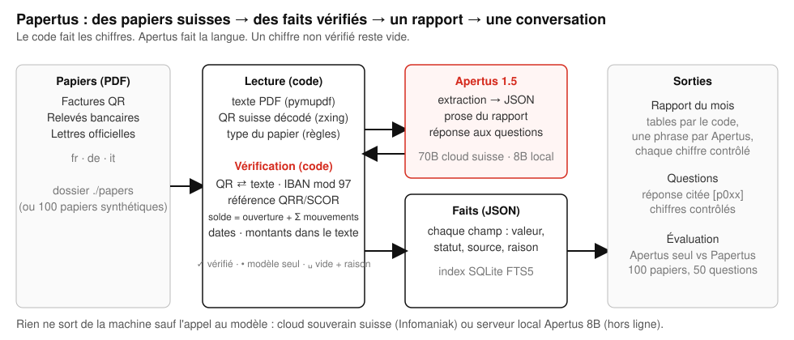

# Rapport technique — Papertus

Parler à ses propres papiers, sur son propre ordinateur portable, avec un petit modèle suisse. Construit avec Apertus 1.5.

- **Volet :** Track 2B — Papertus
- **Événement :** En ligne
- **Équipe :** Papertus — Igor Jovicic
- **Démo :** https://github.com/igorjovicic/papertus/blob/main/track_2b/docs/papertus-demo.mp4 (1 min 57 s)
- **Dépôt :** https://github.com/igorjovicic/papertus (`track_2b/`)
- **Ce rapport en anglais, allemand et italien :** `docs/Papertus_Report.pdf` (anglais), `docs/Papertus_Report.de.pdf`, `docs/Papertus_Report.it.pdf` (même contenu, une langue par fichier)

## 1. Résumé

Les papiers administratifs suisses portent leur propre vérité : une facture QR encode le montant, l'IBAN et une référence avec un chiffre de contrôle ; un relevé bancaire doit tomber juste ; une lettre du canton nomme un délai dans un format fixe. Les modèles de langue lisent bien ces papiers et inventent pourtant des chiffres : un acompte soustrait d'un total, un numéro de facture pris pour une référence de paiement, un solde de clôture « corrigé » pour paraître plausible. Papertus sépare les deux métiers. Apertus 1.5 lit les mots et écrit la langue ; du code ordinaire décode le QR, vérifie chaque somme de contrôle, refait chaque addition et compare chaque date, de sorte que chaque chiffre affiché renvoie au papier dont il provient, et qu'un champ que le code ne peut pas confirmer reste **vide avec sa raison** au lieu de devenir une supposition. Sur les faits vérifiés, le code construit le rapport du mois en français, allemand, italien ou anglais avec un court paragraphe d'Apertus dont chaque nombre est contrôlé, et répond aux questions en citant le papier. Le sens de cette conception, c'est qu'elle fonctionne avec un **petit modèle sur un ordinateur portable ordinaire** : le 8B lit, le code prouve, et rien ne quitte la machine. Sur 100 papiers suisses synthétiques avec vérité terrain (40 factures QR, 30 relevés bancaires, 30 lettres officielles, fr/de/it, avec des pièges plantés), Apertus 1.5 70B seul invente 4.5 % des chiffres ; Papertus avec le même 70B en invente **0.0 %** (100 % corrects, rien laissé vide). Avec Apertus 1.5 8B tournant localement sur un ordinateur portable (poids 8 bits, sans internet), le modèle seul invente 8.9 % des chiffres ; Papertus avec le 8B en invente **0.0 %** (99.3 % corrects, 0.7 % vides avec une raison), en une dizaine de secondes par papier. Le petit modèle lit ; le code prouve. Un conteneur, `make run`, et une ligne d'état qui dit lequel des deux répond : « Apertus 8B · sur cette machine · rien ne sort ».

## 2. Architecture

Tout tourne dans un seul conteneur Python 3.12 (FastAPI, port 8640) sur la machine de l'utilisateur. Flux des données, de gauche à droite :

1. **Papiers** — des PDF dans un dossier de dépôt (`./papers`), ou les 100 papiers synthétiques livrés.
2. **Lecture (code)** — extraction du texte avec PyMuPDF ; chaque page rendue à 200 dpi et balayée à la recherche d'un code QR suisse avec zxing-cpp ; la charge utile du QR suisse (SPC/0200) analysée par notre propre module `swissqr` ; le type du papier décidé par des règles (une charge utile SPC → facture QR ; vocabulaire de relevé en fr/de/it → relevé bancaire ; sinon lettre officielle), avec un recours au modèle seulement quand les règles sont ambiguës (jamais nécessaire sur les 100 papiers).
3. **Apertus** — un appel par papier : le texte du papier et la liste des clés de son type, réponse en JSON, « inconnu = null, jamais une supposition ». Pas d'outils, pas de boucle d'agent.
4. **Vérification (code, `verify.py`)** — la charge utile du QR l'emporte sur le modèle pour le montant, l'IBAN, la référence et le créancier ; chiffres de contrôle IBAN mod 97, QRR modulo 10 récursif et SCOR (ISO 11649) ; chaque montant doit apparaître dans le texte dans un format suisse (`1'234.50`, `1 234.50`, `1234.—`) ; les dates doivent être valides et l'échéance postérieure à la date de facture ; le solde d'ouverture d'un relevé plus ses mouvements doit égaler le solde de clôture imprimé au centime près, et les sommes des débits et des crédits doivent égaler la ligne des totaux imprimée du relevé (une seule erreur de signe sur exactement un mouvement est réparée à partir de ces totaux ; deux candidats → refus) ; un IBAN tronqué par le modèle est complété à partir du texte seulement si la forme complétée passe le mod 97. Chaque champ reçoit un statut : **vérifié** (avec sa source : qr, iban, qrr, text, arithmetic, date), **modèle** (lu par Apertus, non prouvable par le code) ou **vide** (avec le contrôle échoué comme raison).
5. **Faits** — un JSON par papier, mis en cache par empreinte du fichier, indexé dans SQLite FTS5 (pas de base vectorielle, pas de modèle de plongement).
6. **Sorties** — le rapport du mois (tables calculées par le code ; un paragraphe de ≤ 80 mots par Apertus à partir des tables en JSON, chaque phrase passée par `numbers_grounded`, qui écarte toute phrase portant un nombre absent des tables), et les questions (règles d'abord pour les sommes, soldes, comptages et délais ; sinon les faits des six meilleurs papiers vont à Apertus, qui doit citer `[p0xx]` ; chaque nombre de la réponse est contrôlé contre les faits cités, et une réponse non fondée est remplacée par « Je ne trouve pas ce chiffre dans vos papiers » ; aucun résultat de recherche → aucun appel au modèle).

La page suit le style international suisse (une seule police, une grille, noir sur blanc, un seul rouge pour ce qui est prouvé) et indique dans son en-tête quel modèle répond et où il tourne. Le banc d'évaluation (`eval.py`) exécute le même pipeline et une base de référence sur les papiers livrés et écrit `docs/results.md`.

### Architecture cible (obligatoire)

- **b) Isolé du réseau — le déploiement visé.** Le conteneur plus un serveur Apertus 1.5 8B sur la même machine ou le même réseau (vLLM ou un serveur GGUF, tous deux compatibles OpenAI ; les chiffres du § 5 ont été mesurés avec les poids 8 bits servis localement sur un ordinateur portable). Aucun autre accès réseau n'existe à l'exécution : pas de CDN, pas de polices, pas de télémétrie, pas de téléchargement de paquet. L'en-tête affiche « Apertus 8B · sur cette machine · rien ne sort » dès que `LLM_BASE_URL` pointe vers la machine locale.
- **c) Cloud souverain suisse — l'alternative.** Le même conteneur avec `LLM_BASE_URL` sur Apertus 1.5 70B servi par Infomaniak (Genève) via l'API compatible OpenAI. Seul le texte des papiers atteint ce point d'accès ; l'en-tête dit alors « Apertus 70B · cloud suisse ».
- **a) Sur site** découle de (b).

**Dépendances.** À la construction : l'image `python:3.12-slim-bookworm` et les paquets épinglés de `requirements.txt` (fastapi, uvicorn, httpx, pymupdf, zxing-cpp, segno, reportlab, pillow, python-multipart, pytest). À l'exécution : uniquement le `LLM_BASE_URL` configuré. Pas de serveur de base de données, pas de GPU dans le conteneur. Les trois variables `LLM_NAME`, `LLM_BASE_URL`, `LLM_API_KEY` viennent de `.env` ou du shell.

## 3. Usage d'Apertus

- **Modèles :** `swiss-ai/Apertus-v1.5-8B` (la configuration portable, poids 8 bits, servi localement) et `swiss-ai/Apertus-v1.5-70B` (développement et configuration cloud).
- **Comment il est utilisé :** inférence uniquement, trois tâches étroites : (1) extraction structurée des faits d'un papier en JSON, (2) un paragraphe de prose de rapport à partir des tables, (3) une réponse citée à une question à partir des faits d'au plus six papiers. Pas de fine-tuning, pas de boucle d'agent, pas d'outils.
- **Où il tourne :** le 8B sur la machine de l'utilisateur derrière un serveur compatible OpenAI ; le 70B sur un cloud souverain suisse (Infomaniak).
- **Prompts :** de courts prompts système en anglais avec le texte du papier tel quel (`src/*/read.py`, `report.py`, `ask.py`). Température 0. Le JSON est demandé dans le prompt ; `response_format` et `chat_template_kwargs: {enable_thinking: false}` sont chacun essayés une fois et abandonnés quand un serveur les refuse (le point d'accès hébergé refuse le premier ; le serveur local a besoin du second, sans quoi Apertus 1.5 répond avec un bloc de raisonnement, que le client retire aussi). Un JSON tronqué est réparé par le code (fermeture des chaînes et des crochets ouverts) avant l'analyse. Une chaîne de nouvelles tentatives avec temporisation sur 429/5xx/dépassements de délai.
- **Aucun autre modèle** n'est utilisé nulle part, pas même comme juge : toute la notation est une comparaison exacte avec la vérité terrain par le code. Un test (`tests/test_guard.py`) échoue si une autre famille de modèles est nommée dans le dépôt.

## 4. Données

- **Papiers :** 100 PDF synthétiques générés par `src/*/generate.py` (`make data`, graine 42, reproductibles à l'octet près) : 40 factures QR (32 avec un vrai code QR suisse, 27 QRR sur des QR-IBAN, 3 SCOR, 2 sans référence ; 8 sans QR), 30 relevés bancaires (5 volontairement déséquilibrés), 30 lettres officielles (décisions de taxation, commandements de payer d'un Office des poursuites, avis de primes de caisse-maladie, avis communaux, décisions d'autorisation). Langues : 40 fr, 40 de, 20 it. Dates d'août à octobre 2026. Chaque papier porte des **pièges plantés** consignés dans son fichier de vérité : un second montant dans le texte (acompte déjà versé, net contre brut), une date de pied de page qui n'est pas la date de facture, un nom de créancier dans le texte qui s'écarte du QR, des formats de nombres suisses, des lettres sans aucun montant, des factures sans QR. 1.5 Mo au total, y compris un cache livré des 100 lectures pour que `make run` montre les papiers tout de suite sans appel au modèle.
- **Vérité terrain :** un JSON par papier (`data/truth/`), valeurs brutes ; `balanced: false` sur les cinq relevés déséquilibrés, où la bonne réponse pour le solde de clôture est un vide.
- **Questions :** `data/questions.json`, 50 questions en fr/de/it construites à partir de la vérité (montants dus, soldes à une date, factures échues à une date, comptages et totaux par mois, délais d'une autorité), chacune avec sa valeur attendue et les identifiants des papiers qui y répondent.
- **Source et licence :** tout est généré ; chaque personne, entreprise, adresse, IBAN et référence est fictive (les IBAN et les références ont des chiffres de contrôle valides pour que les contrôles soient réels, mais aucun compte n'existe). Pas de données personnelles, pas de document réel, pas de sujets humains. Données : CDLA-Permissive-2.0. Code : Apache-2.0. Documentation : CC-BY-4.0.
- **Ce qui n'est pas dans le dépôt :** les papiers personnels de l'auteur, qui n'ont jamais été utilisés ; le cache d'exécution ; la moindre clé.

## 5. Évaluation

**Tâche.** Pour chaque papier, extraire les champs de son type (montant, IBAN, référence, dates, soldes, mouvements, délai…) et comparer avec la vérité : nombres à 0.01 près, dates exactes, identifiants sans espaces ni casse. Un champ est **correct**, **inventé** (une valeur non nulle qui diffère de la vérité) ou **vide** (null, ou vide avec une raison). La métrique principale est le taux d'invention : un chiffre inventé sur un papier administratif est l'échec coûteux ; un vide est un échec visible. Pour les cinq relevés déséquilibrés, le bon solde de clôture est un vide. Pour les questions, correspondance exacte du nombre, de la date, du comptage ou de la liste avec la vérité ; une réponse « introuvable » ne compte comme correcte que lorsque la vérité elle-même attend un vide.

**Base de référence.** Le même modèle Apertus, même température, recevant le texte brut du papier et les mêmes clés, sans décodage du QR ni contrôles ; sa réponse est prise telle quelle. Pour les questions, deux bases de référence : le texte brut de tous les papiers dans un seul prompt (plafonné à 28 000 caractères, donc la plupart des papiers sont absents) et, plus équitable, le texte brut des mêmes papiers que notre recherche sélectionne, sans exigence de citation ni contrôles.

**Résultats avec Apertus 1.5 70B** (100 papiers, point d'accès Infomaniak, 4 travailleurs en parallèle ; tables complètes dans `docs/results.md`, chiffres bruts dans `docs/results.json`) :

| Configuration | Métrique | Résultat |
|---|---|---|
| Baseline (Apertus seul) | champs corrects | 88.9 % |
| Baseline | **champs inventés** | **4.5 %** |
| Baseline | champs vides | 6.5 % |
| Baseline | type du papier correct | 91.0 % |
| Baseline | listes de mouvements des relevés correctes | 2 / 30 |
| Baseline | questions exactes, tous les textes dans un seul prompt, plafonné à 28 000 caractères (20 q) | 30.0 % |
| Baseline + retrieval | questions exactes, mêmes papiers que les nôtres en texte brut, réponse libre (20 q) | 95.0 % |
| Ours (Papertus) | champs corrects | 100 % |
| Ours | **champs inventés** | **0.0 %** |
| Ours | champs vides (avec raison) | 0.0 % |
| Ours | type du papier correct (règles, aucun appel au modèle) | 100 % |
| Ours | listes de mouvements des relevés correctes | 30 / 30 |
| Ours | questions exactes (50 q, chemin produit : les 50 répondues par les règles, 0 appel au modèle) | 100 % |
| Ours | questions exactes sur les 20 q de la base de référence | 100 % |
| Baseline / Ours | jetons par papier | 1 456 / 1 111 |
| Baseline / Ours | secondes par papier | 6.1 / 6.4 |

**Résultats avec Apertus 1.5 8B sur un ordinateur portable** (mêmes 100 papiers et questions, poids 8 bits servis localement, une requête à la fois ; `docs/results-8b.md`) :

| Configuration | Métrique | Résultat |
|---|---|---|
| Baseline 8B | champs corrects / inventés / vides | 89.6 % / **8.9 %** / 1.5 % |
| Ours 8B | champs corrects / inventés / vides | 99.3 % / **0.0 %** / 0.7 % |
| Baseline 8B / Ours 8B | listes de mouvements des relevés correctes | 5 / 30 → 24 / 30 (les 6 autres vides avec leur raison) |
| Baseline 8B (tous les textes) / + retrieval / Ours 8B (chemin produit) | questions exactes | 25 % / 100 % / 100 % |
| Baseline 8B / Ours 8B | secondes par papier sur l'ordinateur portable (une requête à la fois) | 9.1 / 10.6 |

Par type avec le 70B (corrects / inventés / vides) : factures QR, base de référence 93.2 / 6.8 / 0 → la nôtre 100 / 0 / 0 ; relevés bancaires 96.0 / 4.0 / 0 → 100 / 0 / 0 ; lettres officielles 70.0 / 0 / 30.0 → 100 / 0 / 0.

Ce que la base de référence invente : un solde de clôture sur cinq relevés (elle « corrige » le chiffre imprimé ou recopie celui d'ouverture), une référence et un type de référence sur les dix factures sans QR (elle promeut le numéro de facture), un IBAN ; ses listes de mouvements incluent les lignes de solde sur 28 des 30 relevés. Ce que nos contrôles attrapent : le QR l'emporte sur quatorze noms de créancier déviants et sur chaque montant ; la règle arithmétique vide les cinq relevés déséquilibrés avec la raison explicite (« opening 10'419.90 + movements = 1'988.80, statement says 2'051.40 ») ; la ligne des totaux attrape les erreurs de signe des mouvements et répare celles qui sont uniques ; les lettres sans montant restent vides. Avec le 70B, rien ne reste vide : le seul relevé où le modèle a perdu deux signes est résolu par le solveur de signes, parce qu'exactement une attribution de signes reproduit les totaux imprimés des débits et des crédits. Avec le 8B, qui renvoie plusieurs relevés avec tous les montants positifs ou un montant mal lu, six relevés gardent leurs mouvements et leur solde de clôture vides avec la raison imprimée (« movement_totals: debits 3352.10 / credits 6180.10, printed 3374.20 / 6158.00 ») : des vides honnêtes, rien d'inventé. La table par champ du 8B montre où un petit modèle diffère d'un grand avant les contrôles : il invente le type de référence sur 34 des 40 factures et les listes de mouvements sur 25 des 30 relevés ; après les contrôles, 0 et 0.

Les questions, lues honnêtement : les 50 questions sont dérivées de gabarits sur la vérité (montants dus, soldes, listes d'échéances, comptages, délais), et les réponses par règles ont été construites pour ces types ; 100 % mesure donc la recherche et l'ancrage sur 100 papiers, pas la réponse à des questions ouvertes. La comparaison équitable est la ligne « Baseline + retrieval » : avec les bons papiers en main, Apertus seul répond juste à 95 % (son unique erreur a pris le solde d'un relevé voisin) ; Papertus ajoute les 5 % restants, la citation, et la garantie qu'une réponse ne porte jamais un nombre absent d'un fait vérifié. Les écarts décisifs sont l'extraction (inventés 4.5 % → 0 %, listes de mouvements 2/30 → 30/30) et la recherche (30 % → 100 % quand les papiers ne sont pas fournis). Il en va de même avec le 8B : les 50 questions sont répondues par les règles sur les faits vérifiés, sans aucun appel au modèle, si bien que le score aux questions ne dépend pas de la taille du modèle ; la taille du modèle ne se voit que dans le nombre de faits que les contrôles ont pu vérifier (0.7 % de vides avec le 8B contre 0 % avec le 70B).

## 6. Limites

- **Papiers synthétiques.** Les pièges sont ceux que nous connaissons des vrais papiers suisses, mais les mises en page sont les nôtres et le texte est né numérique. Les papiers scannés ont besoin d'une étape d'OCR en amont (les contrôles s'appliquent inchangés au texte OCR, et le décodeur QR fonctionne déjà sur des images rendues).
- **L'extraction du texte perd les colonnes.** Les colonnes débit/crédit ressortent comme un montant par ligne ; le modèle déduit le signe du libellé et se trompe environ une fois sur quinze mouvements avec le 70B. Le contrôle de la ligne des totaux l'attrape ; la réparation n'est tentée que lorsqu'exactement un mouvement peut expliquer la différence.
- **Trois types de papier.** Les fiches de salaire, polices d'assurance, contrats et e-mails ne sont pas modélisés ; un papier inconnu est traité comme une lettre officielle et la plupart de ses champs seront vides ou issus du modèle seul.
- **Une page par papier** dans le jeu de test ; les relevés de plusieurs pages sont lus page par page mais n'ont pas été mesurés.
- **Couverture des questions.** Les réponses par règles couvrent les sommes, soldes, comptages et délais ; les questions ouvertes vont au modèle avec six papiers de contexte et ne valent que ce que vaut la recherche sur FTS5 (pas de synonymes entre les langues au-delà de nos listes de mots vides et des graphies de dates).
- **L'exécution sur l'ordinateur portable** a utilisé une seule machine (Apple silicon, poids MLX 8 bits) ; d'autres piles de service et d'autres quantifications n'ont pas été mesurées et feront bouger les chiffres.
- **Aucune revue de sécurité** du chemin de téléversement au-delà de PDF uniquement, taille et dédoublonnage par empreinte ; l'application est destinée à la machine d'une seule personne, liée à localhost.

## 7. Reproductibilité

- **Commit :** le tag `hackapertus-2026` sur https://github.com/igorjovicic/papertus (`track_2b/`), l'état soumis le 16 octobre 2026.
- **Exécution :** Docker, `python:3.12-slim-bookworm`, sans GPU. `make run` construit et démarre l'application sur http://localhost:8640 avec les 100 papiers pré-lus depuis le cache livré (`data/cache.json`), de sorte que le premier écran n'a besoin d'aucun appel au modèle ; déposez un nouveau PDF pour voir une lecture en direct. Le cache est indexé par la source du lecteur et le nom du modèle, si bien qu'un autre modèle ou un contrôle modifié lit simplement en direct.
- **Chiffres :** `make data` régénère les 100 papiers à l'octet près (graine 42) ; `make eval` relance la base de référence et la nôtre sur le point d'accès configuré et réécrit `docs/results.md` (≈ 580 k jetons pour les deux méthodes sur 100 papiers et 70 questions, ≈ 11 minutes à 4 travailleurs sur le 70B hébergé ; `make eval TAG=8b` pour un serveur local : environ une heure sur l'ordinateur portable pour les deux méthodes sur 100 papiers et 90 questions, une requête à la fois). L'évaluation met en cache les réponses brutes du modèle dans `runtime/`, si bien que les contrôles peuvent être modifiés et rejoués sans coût en jetons.
- **Tests :** `make test` exécute 83 tests unitaires (contrôles, charges utiles QR, vecteurs IBAN/QRR/SCOR, tables du rapport, réponses par règles, le chemin sans appel, les routes web) plus la garde des noms interdits ; quatre tests en direct s'exécutent quand `LLM_API_KEY` est défini.
- **Points d'accès utilisés pour les chiffres rapportés :** Infomaniak AI tools, `swiss-ai/Apertus-v1.5-70B`, température 0, 14–15 octobre 2026 ; un serveur local compatible OpenAI avec la conversion MLX 8 bits de `swiss-ai/Apertus-v1.5-8B` sur un ordinateur portable Apple silicon, 15 octobre 2026, `chat_template_kwargs: {enable_thinking: false}`.
- **Outils déclarés :** le code a été écrit pendant la période du hackathon avec un assistant de programmation par IA d'Anthropic sous la direction de l'auteur ; la conception, les contrôles, les tests et chaque chiffre rapporté ont été exécutés et vérifiés par l'auteur.

## 8. Prochaines étapes

Avec un mois de plus : une porte d'entrée OCR pour les papiers photographiés et scannés (les contrôles fonctionnent déjà sur n'importe quel texte) ; les fiches de salaire, polices d'assurance et relevés fiscaux (eCH-0196) comme nouveaux types avec leur propre arithmétique ; une couche de données ouvertes suisses pour que le rapport puisse dire ce qu'un délai signifie (LPC, primes LAMal par canton, calendriers fiscaux) ; un installateur en un clic qui livre les poids du 8B avec le conteneur pour un ordinateur portable de 16 Go ; une vue de l'année (ce qui est entré, ce qui est sorti, ce qui est encore ouvert) qu'une fiduciaire peut remettre à un client ; et un jeu d'évaluation public sur Hugging Face pour que d'autres projets Apertus puissent être mesurés sur les mêmes papiers suisses.

## Licence

Creative Commons Attribution 4.0 (CC-BY-4.0) pour ce rapport et la documentation. Code Apache-2.0, données CDLA-Permissive-2.0. Tous les projets HackApertus sont publiés en source ouverte.

## Références

- Swiss Payment Standards, *Swiss Implementation Guidelines QR-bill*, SIX, version 2.3 (charge utile QR, références QRR et SCOR).
- ISO 7064 MOD 97-10 (chiffres de contrôle IBAN et SCOR) ; ISO 11649 (référence du créancier).
- Swiss AI Initiative, fiches de modèle *Apertus v1.5*, huggingface.co/swiss-ai, 2026.
- PyMuPDF, zxing-cpp, segno, reportlab, FastAPI (voir `requirements.txt` pour les versions et les licences).
