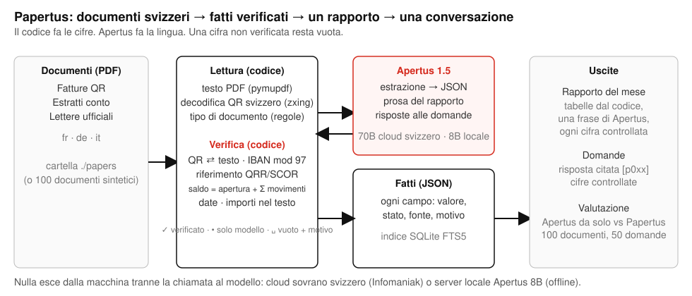

# Rapporto tecnico — Papertus

Parlate con i vostri documenti, sul vostro computer portatile, con un piccolo modello svizzero. Costruito con Apertus 1.5.

- **Categoria:** Track 2B — Papertus
- **Evento:** Online
- **Squadra:** Papertus — Igor Jovicic
- **Demo:** https://github.com/igorjovicic/papertus/blob/main/track_2b/docs/papertus-demo.mp4 (1 min 57 s)
- **Repository:** https://github.com/igorjovicic/papertus (`track_2b/`)
- **Questo rapporto in inglese, francese e tedesco:** `docs/Papertus_Report.pdf`, `docs/Papertus_Report.fr.pdf`, `docs/Papertus_Report.de.pdf` (stesso contenuto, una lingua per versione)

## 1. Sintesi

I documenti amministrativi svizzeri portano in sé la propria verità: una fattura QR codifica l'importo, l'IBAN e un riferimento con cifra di controllo; un estratto conto deve tornare; una lettera del Cantone indica un termine in un formato fisso. I modelli linguistici leggono bene questi documenti e tuttavia inventano cifre: un acconto sottratto da un totale, un numero di fattura scambiato per un riferimento di pagamento, un saldo finale « corretto » per sembrare plausibile. Papertus separa i due compiti. Apertus 1.5 legge le parole e scrive la lingua; del semplice codice decodifica il QR, verifica ogni cifra di controllo, rifà ogni somma e confronta ogni data, così che ogni cifra mostrata rimandi al documento da cui proviene, e un campo che il codice non può confermare resta **vuoto con il suo motivo** invece di diventare una supposizione. Sui fatti verificati, il codice costruisce il rapporto del mese in francese, tedesco, italiano o inglese con un breve paragrafo di Apertus di cui ogni numero è controllato, e risponde alle domande citando il documento. Il senso del progetto è che funziona con un **piccolo modello su un computer portatile comune**: l'8B legge, il codice dimostra, e nulla esce dalla macchina. Su 100 documenti svizzeri sintetici con verità di riferimento (40 fatture QR, 30 estratti conto, 30 lettere ufficiali, fr/de/it, con trappole piantate), Apertus 1.5 70B da solo inventa il 4.5 % delle cifre; Papertus con lo stesso 70B inventa lo **0.0 %** (100 % corrette, nulla lasciato vuoto). Con Apertus 1.5 8B eseguito localmente su un computer portatile (pesi a 8 bit, senza internet), il modello da solo inventa l'8.9 % delle cifre; Papertus con l'8B inventa lo **0.0 %** (99.3 % corrette, 0.7 % vuote con un motivo), in circa dieci secondi per documento. Il piccolo modello legge; il codice dimostra. Un solo container, `make run`, e una riga di stato che dice quale dei due è in uso: « Apertus 8B · su questo computer · nulla esce ».

## 2. Architettura

Tutto gira in un solo container Python 3.12 (FastAPI, porta 8640) sulla macchina dell'utente. Flusso dei dati, da sinistra a destra:

1. **Documenti** — PDF in una cartella di deposito (`./papers`), oppure i 100 documenti sintetici forniti.
2. **Lettura (codice)** — estrazione del testo con PyMuPDF; ogni pagina resa a 200 dpi e scandita alla ricerca di un codice QR svizzero con zxing-cpp; il contenuto del QR svizzero (SPC/0200) analizzato dal nostro modulo `swissqr`; il tipo di documento deciso da regole (un contenuto SPC → fattura QR; vocabolario da estratto conto in fr/de/it → estratto conto; altrimenti lettera ufficiale), con un ricorso al modello solo quando le regole sono ambigue (mai necessario sui 100 documenti).
3. **Apertus** — una chiamata per documento: il testo del documento e l'elenco delle chiavi per il suo tipo, risposta in JSON, « sconosciuto = null, mai una supposizione ». Nessuno strumento, nessun ciclo di agente.
4. **Verifica (codice, `verify.py`)** — il contenuto del QR prevale sul modello per importo, IBAN, riferimento e creditore; cifre di controllo IBAN mod 97, QRR modulo 10 ricorsivo e SCOR (ISO 11649); ogni importo deve comparire nel testo in un formato svizzero (`1'234.50`, `1 234.50`, `1234.—`); le date devono essere valide e la scadenza posteriore alla data della fattura; il saldo iniziale di un estratto conto più i suoi movimenti deve essere uguale al saldo finale stampato, al centesimo, e le somme di addebiti e accrediti devono essere uguali alla riga dei totali stampata sull'estratto (un unico errore di segno su esattamente un movimento viene riparato a partire da quei totali; due candidati → rifiuto); un IBAN troncato dal modello viene completato dal testo solo se la forma completata supera il mod 97. Ogni campo riceve uno stato: **verificato** (con la sua fonte: qr, iban, qrr, text, arithmetic, date), **modello** (letto da Apertus, non dimostrabile dal codice) o **vuoto** (con il controllo fallito come motivo).
5. **Fatti** — un JSON per documento, in cache per hash del file, indicizzato in SQLite FTS5 (nessun database vettoriale, nessun modello di embedding).
6. **Uscite** — il rapporto del mese (tabelle calcolate dal codice; un paragrafo di ≤ 80 parole di Apertus a partire dalle tabelle in JSON, ogni frase passata da `numbers_grounded`, che elimina qualsiasi frase contenente un numero assente dalle tabelle), e le domande (prima le regole per somme, saldi, conteggi e termini; altrimenti i fatti dei sei documenti migliori vanno ad Apertus, che deve citare `[p0xx]`; ogni numero della risposta è controllato rispetto ai fatti citati, e una risposta non fondata è sostituita da « Non trovo questa cifra nei suoi documenti »; nessun risultato di ricerca → nessuna chiamata al modello).

La pagina segue lo Stile internazionale svizzero (un solo carattere, una griglia, nero su bianco, un solo rosso per ciò che è dimostrato) e indica nell'intestazione quale modello risponde e dove gira. Il banco di valutazione (`eval.py`) esegue la stessa pipeline e una linea di base sui documenti forniti e scrive `docs/results.md`.

### Architettura di destinazione (obbligatoria)

- **b) Isolato dalla rete — l'installazione prevista.** Il container più un server Apertus 1.5 8B sulla stessa macchina o nella stessa rete (vLLM o un server GGUF, entrambi compatibili OpenAI; i numeri del § 5 sono stati misurati con i pesi a 8 bit serviti localmente su un computer portatile). Nessun altro accesso alla rete esiste durante l'esecuzione: nessun CDN, nessun font, nessuna telemetria, nessun download di pacchetti. L'intestazione mostra « Apertus 8B · su questo computer · nulla esce » ogni volta che `LLM_BASE_URL` punta alla macchina locale.
- **c) Cloud sovrano svizzero — l'alternativa.** Lo stesso container con `LLM_BASE_URL` su Apertus 1.5 70B servito da Infomaniak (Ginevra) attraverso l'API compatibile OpenAI. Solo il testo dei documenti raggiunge quell'endpoint; l'intestazione dice allora « Apertus 70B · cloud svizzero ».
- **a) On-premise** deriva da (b).

**Dipendenze.** In fase di build: l'immagine `python:3.12-slim-bookworm` e i pacchetti a versione fissa di `requirements.txt` (fastapi, uvicorn, httpx, pymupdf, zxing-cpp, segno, reportlab, pillow, python-multipart, pytest). In esecuzione: solo il `LLM_BASE_URL` configurato. Nessun server di database, nessuna GPU nel container. Le tre variabili `LLM_NAME`, `LLM_BASE_URL`, `LLM_API_KEY` provengono da `.env` o dalla shell.

## 3. Uso di Apertus

- **Modelli:** `swiss-ai/Apertus-v1.5-8B` (la configurazione portatile, pesi a 8 bit, servito localmente) e `swiss-ai/Apertus-v1.5-70B` (sviluppo e configurazione cloud).
- **Come viene usato:** solo inferenza, tre compiti ristretti: (1) estrazione strutturata dei fatti di un documento in JSON, (2) un paragrafo di prosa del rapporto a partire dalle tabelle, (3) una risposta citata a una domanda a partire dai fatti di al massimo sei documenti. Nessun fine-tuning, nessun ciclo di agente, nessuno strumento.
- **Dove gira:** l'8B sulla macchina dell'utente dietro un server compatibile OpenAI; il 70B su un cloud sovrano svizzero (Infomaniak).
- **Prompt:** brevi prompt di sistema in inglese con il testo del documento riportato tale e quale (`src/*/read.py`, `report.py`, `ask.py`). Temperatura 0. Il JSON è richiesto nel prompt; `response_format` e `chat_template_kwargs: {enable_thinking: false}` sono tentati una volta ciascuno e abbandonati quando un server li rifiuta (l'endpoint ospitato rifiuta il primo; il server locale ha bisogno del secondo, altrimenti Apertus 1.5 risponde con un blocco di ragionamento, che il client comunque rimuove). Il JSON troncato è riparato dal codice (chiusura di stringhe e parentesi aperte) prima dell'analisi. Una catena di nuovi tentativi con attesa progressiva su 429/5xx/timeout.
- **Nessun altro modello** è usato da nessuna parte, nemmeno come giudice: tutto il punteggio è un confronto esatto con la verità di riferimento fatto dal codice. Un test (`tests/test_guard.py`) fallisce se un'altra famiglia di modelli è nominata nel repository.

## 4. Dati

- **Documenti:** 100 PDF sintetici generati da `src/*/generate.py` (`make data`, seme 42, riproducibili byte per byte): 40 fatture QR (32 con un vero codice QR svizzero, 27 QRR su QR-IBAN, 3 SCOR, 2 senza riferimento; 8 senza QR), 30 estratti conto (5 deliberatamente non quadrati), 30 lettere ufficiali (decisioni di tassazione, precetti esecutivi di un Ufficio esecuzioni, avvisi di premio della cassa malati, avvisi del Comune, decisioni su permessi). Lingue: 40 fr, 40 de, 20 it. Date da agosto a ottobre 2026. Ogni documento contiene **trappole piantate** registrate nel suo file di verità: un secondo importo nel testo (acconto già pagato, netto contro lordo), una data a piè di pagina che non è la data della fattura, un nome di creditore nel testo che si discosta dal QR, formati numerici svizzeri, lettere senza alcun importo, fatture senza QR. 1.5 MB in totale, compresa una cache fornita delle 100 letture, così che `make run` mostri subito i documenti senza chiamata al modello.
- **Verità di riferimento:** un JSON per documento (`data/truth/`), valori semplici; `balanced: false` sui cinque estratti non quadrati, dove la risposta corretta per il saldo finale è un vuoto.
- **Domande:** `data/questions.json`, 50 domande in fr/de/it costruite dalla verità (importi dovuti, saldi a una data, fatture in scadenza entro una data, conteggi e totali per mese, termini di un'autorità), ciascuna con il valore atteso e gli id dei documenti che le rispondono.
- **Fonte e licenza:** tutto è generato; ogni persona, azienda, indirizzo, IBAN e riferimento è fittizio (IBAN e riferimenti hanno cifre di controllo valide, perciò i controlli sono reali, ma nessun conto esiste). Nessun dato personale, nessun documento reale, nessun soggetto umano. Dati: CDLA-Permissive-2.0. Codice: Apache-2.0. Documentazione: CC-BY-4.0.
- **Ciò che non è nel repository:** i documenti personali dell'autore, mai usati; la cache di esecuzione; qualsiasi chiave.

## 5. Valutazione

**Compito.** Per ogni documento, estrarre i campi del suo tipo (importo, IBAN, riferimento, date, saldi, movimenti, termine…) e confrontarli con la verità: numeri decimali entro 0.01, date esatte, identificatori senza spazi né distinzione tra maiuscole e minuscole. Un campo è **corretto**, **inventato** (un valore non nullo che differisce dalla verità) o **vuoto** (null, o vuoto con un motivo). La metrica principale è il tasso di inventato: una cifra inventata su un documento amministrativo è l'errore costoso; un vuoto è un errore visibile. Per i cinque estratti non quadrati, il saldo finale corretto è un vuoto. Per le domande, corrispondenza esatta del numero, della data, del conteggio o dell'elenco con la verità; una risposta « non trovato » conta come corretta solo quando la verità stessa prevede un vuoto.

**Linea di base.** Lo stesso modello Apertus, stessa temperatura, con il testo grezzo del documento e le stesse chiavi, senza decodifica del QR e senza controlli; qualunque cosa risponda è presa così com'è. Per le domande, due linee di base: il testo grezzo di tutti i documenti in un solo prompt (limitato a 28 000 caratteri, perciò la maggior parte dei documenti è assente) e, più equa, il testo grezzo degli stessi documenti selezionati dalla nostra ricerca, senza obbligo di citazione e senza controlli.

**Risultati con Apertus 1.5 70B** (100 documenti, endpoint Infomaniak, 4 processi in parallelo; tabelle complete in `docs/results.md`, numeri grezzi in `docs/results.json`):

| Configurazione | Metrica | Risultato |
|---|---|---|
| Baseline (solo Apertus) | campi corretti | 88.9 % |
| Baseline | **campi inventati** | **4.5 %** |
| Baseline | campi vuoti | 6.5 % |
| Baseline | tipo di documento corretto | 91.0 % |
| Baseline | elenchi di movimenti degli estratti corretti | 2 / 30 |
| Baseline | domande esatte, tutti i testi in un solo prompt, limite 28 000 caratteri (20 d.) | 30.0 % |
| Baseline + ricerca | domande esatte, stessi documenti dei nostri come testo grezzo, risposta libera (20 d.) | 95.0 % |
| Ours (Papertus) | campi corretti | 100 % |
| Ours | **campi inventati** | **0.0 %** |
| Ours | campi vuoti (con motivo) | 0.0 % |
| Ours | tipo di documento corretto (regole, nessuna chiamata al modello) | 100 % |
| Ours | elenchi di movimenti degli estratti corretti | 30 / 30 |
| Ours | domande esatte (50 d., percorso prodotto: tutte le 50 risposte dalle regole, 0 chiamate al modello) | 100 % |
| Ours | domande esatte sulle 20 d. della linea di base | 100 % |
| Baseline / Ours | token per documento | 1 456 / 1 111 |
| Baseline / Ours | secondi per documento | 6.1 / 6.4 |

**Risultati con Apertus 1.5 8B su un computer portatile** (stessi 100 documenti e stesse domande, pesi a 8 bit serviti localmente, una richiesta alla volta; `docs/results-8b.md`):

| Configurazione | Metrica | Risultato |
|---|---|---|
| Baseline 8B | campi corretti / inventati / vuoti | 89.6 % / **8.9 %** / 1.5 % |
| Ours 8B | campi corretti / inventati / vuoti | 99.3 % / **0.0 %** / 0.7 % |
| Baseline 8B / Ours 8B | elenchi di movimenti degli estratti corretti | 5 / 30 → 24 / 30 (gli altri 6 vuoti con il loro motivo) |
| Baseline 8B (tutti i testi) / + ricerca / Ours 8B (percorso prodotto) | domande esatte | 25 % / 100 % / 100 % |
| Baseline 8B / Ours 8B | secondi per documento sul portatile (una richiesta alla volta) | 9.1 / 10.6 |

Per tipo con il 70B (corretti / inventati / vuoti): fatture QR linea di base 93.2 / 6.8 / 0 → nostro 100 / 0 / 0; estratti conto 96.0 / 4.0 / 0 → 100 / 0 / 0; lettere ufficiali 70.0 / 0 / 30.0 → 100 / 0 / 0.

Ciò che la linea di base inventa: un saldo finale su cinque estratti (« corregge » la cifra stampata o copia quella iniziale), un riferimento e un tipo di riferimento sulle dieci fatture senza QR (promuove il numero di fattura), un IBAN; i suoi elenchi di movimenti includono le righe dei saldi su 28 estratti su 30. Ciò che i nostri controlli intercettano: il QR prevale su quattordici nomi di creditore discostati e su ogni importo; la regola aritmetica lascia vuoti i cinque estratti non quadrati con il motivo esplicito (« opening 10'419.90 + movements = 1'988.80, statement says 2'051.40 »); la riga dei totali intercetta gli errori di segno nei movimenti e ripara quelli univoci; le lettere senza importo restano vuote. Con il 70B nulla resta vuoto: l'unico estratto in cui il modello ha perso due segni è risolto dal risolutore di segni, perché esattamente un'assegnazione di segni riproduce i totali stampati di addebiti e accrediti. Con l'8B, che restituisce diversi estratti con tutti gli importi positivi o un importo letto male, sei estratti conservano i movimenti e il saldo finale vuoti con il motivo stampato (« movement_totals: debits 3352.10 / credits 6180.10, printed 3374.20 / 6158.00 »): vuoti onesti, nulla di inventato. La tabella per campo dell'8B mostra dove un piccolo modello differisce da uno grande prima dei controlli: inventa il tipo di riferimento su 34 fatture su 40 e gli elenchi di movimenti su 25 estratti su 30; dopo i controlli, 0 e 0.

Le domande, lette onestamente: le 50 domande sono costruite da modelli a partire dalla verità (importi dovuti, saldi, elenchi di scadenze, conteggi, termini), e le risposte da regole sono state costruite per quei tipi, perciò il 100 % misura la ricerca e la fondatezza su 100 documenti, non la risposta a domande aperte. Il confronto equo è la riga « Baseline + ricerca »: con i documenti giusti in mano, Apertus da solo risponde al 95 % (il suo unico errore ha preso il saldo di un estratto vicino); Papertus aggiunge l'ultimo 5 %, la citazione, e la garanzia che una risposta non porti mai un numero assente da un fatto verificato. Gli scarti decisivi sono l'estrazione (inventato 4.5 % → 0 %, elenchi di movimenti 2/30 → 30/30) e la ricerca (30 % → 100 % quando i documenti non vengono consegnati). Lo stesso vale con l'8B: tutte le 50 domande sono risposte dalle regole sui fatti verificati, senza alcuna chiamata al modello, perciò il punteggio delle domande non dipende dalla taglia del modello; la taglia del modello si vede solo nel numero di fatti che i controlli hanno potuto verificare (0.7 % di vuoti con l'8B contro 0 % con il 70B).

## 6. Limiti

- **Documenti sintetici.** Le trappole sono quelle che conosciamo dai veri documenti svizzeri, ma le impaginazioni sono nostre e il testo nasce digitale. I documenti scansionati hanno bisogno di un passaggio OCR a monte (i controlli si applicano invariati al testo OCR, e il decodificatore QR funziona già su immagini rese).
- **L'estrazione del testo perde le colonne.** Le colonne dare/avere escono come un importo per riga; il modello deduce il segno dall'etichetta e sbaglia circa una volta su quindici movimenti con il 70B. Il controllo della riga dei totali lo intercetta; la riparazione è tentata solo quando esattamente un movimento può spiegare la differenza.
- **Tre tipi di documento.** Buste paga, polizze assicurative, contratti ed e-mail non sono modellati; un documento sconosciuto è trattato come lettera ufficiale e la maggior parte dei suoi campi sarà vuota o solo modello.
- **Una pagina per documento** nel set di prova; gli estratti su più pagine sono letti pagina per pagina ma non sono stati misurati.
- **Copertura delle domande.** Le risposte da regole coprono somme, saldi, conteggi e termini; le domande aperte vanno al modello con sei documenti di contesto e valgono quanto la ricerca su FTS5 (nessun sinonimo tra lingue oltre ai nostri elenchi di stopword e alle grafie delle date).
- **L'esecuzione sul portatile** ha usato una sola macchina (Apple silicon, pesi MLX a 8 bit); altre pile di serving e altre quantizzazioni non sono state misurate e sposteranno i numeri.
- **Nessuna revisione di sicurezza** del percorso di caricamento oltre a solo PDF, dimensione e deduplicazione per hash; l'app è pensata per la macchina di una sola persona, legata a localhost.

## 7. Riproducibilità

- **Commit:** il tag `hackapertus-2026` su https://github.com/igorjovicic/papertus (`track_2b/`), lo stato inviato il 16 ottobre 2026.
- **Esecuzione:** Docker, `python:3.12-slim-bookworm`, nessuna GPU. `make run` costruisce e avvia l'app su http://localhost:8640 con i 100 documenti già letti dalla cache fornita (`data/cache.json`), perciò la prima schermata non ha bisogno di alcuna chiamata al modello; depositate un nuovo PDF per vedere una lettura dal vivo. La cache è indicizzata per sorgente del lettore e nome del modello, perciò un modello diverso o un controllo modificato legge semplicemente dal vivo.
- **Numeri:** `make data` rigenera i 100 documenti byte per byte (seme 42); `make eval` riesegue linea di base e nostro sull'endpoint configurato e riscrive `docs/results.md` (≈ 580 k token per i due metodi su 100 documenti e 70 domande, ≈ 11 minuti con 4 processi sul 70B ospitato; `make eval TAG=8b` per un server locale: circa un'ora sul portatile per i due metodi su 100 documenti e 90 domande, una richiesta alla volta). La valutazione mette in cache le risposte grezze del modello in `runtime/`, perciò i controlli possono essere modificati e rieseguiti a costo zero in token.
- **Test:** `make test` esegue 83 test unitari (controlli, contenuti QR, vettori IBAN/QRR/SCOR, tabelle del rapporto, risposte da regole, il percorso senza chiamata, le rotte web) più la guardia sui nomi vietati; quattro test dal vivo girano quando `LLM_API_KEY` è impostata.
- **Endpoint usati per i numeri riportati:** Infomaniak AI tools, `swiss-ai/Apertus-v1.5-70B`, temperatura 0, 14–15 ottobre 2026; un server locale compatibile OpenAI con la conversione MLX a 8 bit di `swiss-ai/Apertus-v1.5-8B` su un portatile Apple silicon, 15 ottobre 2026, `chat_template_kwargs: {enable_thinking: false}`.
- **Dichiarazione sugli strumenti:** il codice è stato scritto durante il periodo dell'hackathon con un assistente di programmazione IA di Anthropic sotto la direzione dell'autore; il progetto, i controlli, i test e ogni numero riportato sono stati eseguiti e verificati dall'autore.

## 8. Prossimi passi

Con un altro mese: una porta d'ingresso OCR per i documenti fotografati e scansionati (i controlli funzionano già su qualsiasi testo); buste paga, polizze assicurative e certificati fiscali (eCH-0196) come nuovi tipi con la propria aritmetica; uno strato di dati aperti svizzeri perché il rapporto possa dire che cosa significa un termine (LPC, premi LAMal per Cantone, calendari fiscali); un installatore a un clic che fornisce i pesi dell'8B con il container per un portatile da 16 GB; una vista annuale (che cosa è entrato, che cosa è uscito, che cosa è ancora aperto) che un fiduciario possa consegnare a un cliente; e un set di valutazione pubblico su Hugging Face perché altri progetti Apertus possano essere misurati sugli stessi documenti svizzeri.

## Licenza

Creative Commons Attribution 4.0 (CC-BY-4.0) per questo rapporto e la documentazione. Codice Apache-2.0, dati CDLA-Permissive-2.0. Tutti i progetti HackApertus sono open source.

## Riferimenti

- Swiss Payment Standards, *Swiss Implementation Guidelines QR-bill*, SIX, versione 2.3 (contenuto del QR, riferimenti QRR e SCOR).
- ISO 7064 MOD 97-10 (cifre di controllo IBAN e SCOR); ISO 11649 (riferimento del creditore).
- Swiss AI Initiative, schede dei modelli *Apertus v1.5*, huggingface.co/swiss-ai, 2026.
- PyMuPDF, zxing-cpp, segno, reportlab, FastAPI (vedi `requirements.txt` per versioni e licenze).
