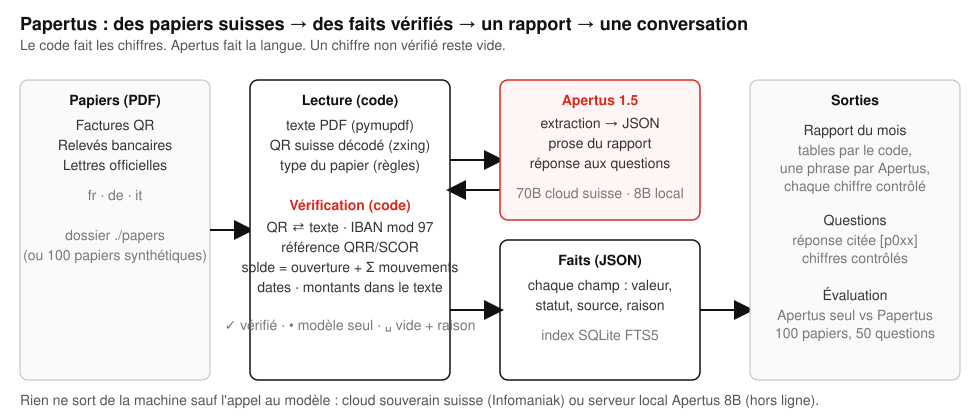

# Technical report — Papertus

Talk to your own papers, on your own laptop, with a small Swiss model. Built with Apertus 1.5.

- **Track:** Track 2B — Papertus
- **Event:** Online
- **Team:** Papertus — Igor Jovicic
- **Demo:** https://github.com/igorjovicic/papertus/blob/main/track_2b/docs/papertus-demo.mp4 (1 min 57 s)
- **Repository:** https://github.com/igorjovicic/papertus (`track_2b/`)
- **This report in French, German and Italian:** `docs/Papertus_Report.fr.pdf`, `docs/Papertus_Report.de.pdf`, `docs/Papertus_Report.it.pdf` (same content, one language each)

## 1. Summary

Swiss administrative papers carry their own truth: a QR-bill encodes the amount, the IBAN and a reference with a check digit; a bank statement must add up; a letter from the canton names a deadline in a fixed format. Language models read these papers well and still invent figures: a deposit subtracted from a total, an invoice number taken for a payment reference, a closing balance "corrected" to look plausible. Papertus separates the two jobs. Apertus 1.5 reads the words and writes the language; plain code decodes the QR, checks every checksum, redoes every sum and compares every date, so that each figure shown points back to the paper it came from, and a field the code cannot confirm stays **blank with its reason** instead of becoming a guess. On the verified facts, code builds the month's report in French, German, Italian or English with one short paragraph by Apertus whose every number is checked, and answers questions with the paper cited. The point of the design is that it works with a **small model on an ordinary laptop**: the 8B does the reading, the code does the proving, and nothing leaves the machine. On 100 synthetic Swiss papers with ground truth (40 QR-bills, 30 bank statements, 30 official letters, fr/de/it, with planted traps), Apertus 1.5 70B alone invents 4.5 % of the figures; Papertus with the same 70B invents **0.0 %** (100 % correct, nothing left blank). With Apertus 1.5 8B running locally on a laptop (8-bit weights, no internet), the model alone invents 8.9 % of the figures; Papertus with the 8B invents **0.0 %** (99.3 % correct, 0.7 % blank with a reason), at about ten seconds per paper. The small model reads; the code proves. One container, `make run`, and a status line that tells you which it is: "Apertus 8B · on this machine · nothing leaves".

## 2. Architecture

Everything runs in one Python 3.12 container (FastAPI, port 8640) on the user's machine. Data flow, left to right:

1. **Papers** — PDFs in a drop folder (`./papers`), or the 100 shipped synthetic papers.
2. **Reading (code)** — text extraction with PyMuPDF; each page rendered at 200 dpi and scanned for a Swiss QR code with zxing-cpp; the Swiss QR payload (SPC/0200) parsed by our own `swissqr` module; the paper kind decided by rules (a SPC payload → QR-bill; statement vocabulary in fr/de/it → bank statement; else official letter), with a model fallback only when the rules are ambiguous (never needed on the 100 papers).
3. **Apertus** — one call per paper: the paper's text and the list of keys for its kind, answer as JSON, "unknown = null, never a guess". No tools, no agent loop.
4. **Verification (code, `verify.py`)** — the QR payload wins over the model for amount, IBAN, reference and creditor; IBAN mod-97, QRR modulo-10 recursive and SCOR (ISO 11649) check digits; every amount must appear in the text in a Swiss format (`1'234.50`, `1 234.50`, `1234.—`); dates must be valid and the due date after the invoice date; a statement's opening balance plus its movements must equal the printed closing balance to the centime, and the sums of debits and credits must equal the statement's printed totals line (a single sign error on exactly one movement is repaired from those totals; two candidates → refused); an IBAN the model truncated is completed from the text only if the completed form passes mod-97. Each field gets a status: **verified** (with its source: qr, iban, qrr, text, arithmetic, date), **model** (read by Apertus, not provable by code) or **blank** (with the failed check as reason).
5. **Facts** — JSON per paper, cached by file hash, indexed in SQLite FTS5 (no vector database, no embedding model).
6. **Outputs** — the month's report (tables computed by code; one ≤ 80-word paragraph by Apertus from the tables as JSON, every sentence passed through `numbers_grounded`, which drops any sentence carrying a number absent from the tables), and questions (rules first for sums, balances, counts and deadlines; otherwise the facts of the top six papers go to Apertus, which must cite `[p0xx]`; every number in the answer is checked against the cited facts, and an ungrounded answer is replaced by "I can't find that figure in your papers"; no retrieval hit → no model call).

The page follows the Swiss International Style (one typeface, a grid, black on white, one red for what is proven) and states in its header which model is answering and where it runs. The evaluation harness (`eval.py`) runs the same pipeline and a baseline on the shipped papers and writes `docs/results.md`.

### Target architecture (mandatory)

- **b) Air-gapped — the intended deployment.** The container plus an Apertus 1.5 8B server on the same machine or network (vLLM or a GGUF server, both OpenAI-compatible; the numbers in § 5 were measured with the 8-bit weights served locally on a laptop). No other network access exists at runtime: no CDN, no fonts, no telemetry, no package download. The header shows "Apertus 8B · on this machine · nothing leaves" whenever `LLM_BASE_URL` points at the local machine.
- **c) Sovereign Swiss cloud — the alternative.** The same container with `LLM_BASE_URL` on Apertus 1.5 70B served by Infomaniak (Geneva) through the OpenAI-compatible API. Only the text of the papers reaches that endpoint; the header then says "Apertus 70B · Swiss cloud".
- **a) On-premise** follows from (b).

**Dependencies.** Build time: the `python:3.12-slim-bookworm` image and the pinned packages of `requirements.txt` (fastapi, uvicorn, httpx, pymupdf, zxing-cpp, segno, reportlab, pillow, python-multipart, pytest). Runtime: only the configured `LLM_BASE_URL`. No database server, no GPU in the container. The three variables `LLM_NAME`, `LLM_BASE_URL`, `LLM_API_KEY` come from `.env` or from the shell.

## 3. Use of Apertus

- **Models:** `swiss-ai/Apertus-v1.5-8B` (the laptop configuration, 8-bit weights, served locally) and `swiss-ai/Apertus-v1.5-70B` (development and the cloud configuration).
- **How it is used:** inference only, three narrow jobs: (1) structured extraction of a paper's facts to JSON, (2) one paragraph of report prose from tables, (3) a cited answer to a question from the facts of at most six papers. No fine-tuning, no agent loop, no tools.
- **Where it runs:** the 8B on the user's machine behind an OpenAI-compatible server; the 70B on a Swiss sovereign cloud (Infomaniak).
- **Prompts:** short English system prompts with the paper text verbatim (`src/*/read.py`, `report.py`, `ask.py`). Temperature 0. JSON is requested in the prompt; `response_format` and `chat_template_kwargs: {enable_thinking: false}` are each tried once and dropped when a server rejects them (the hosted endpoint rejects the first; the local server needs the second or Apertus 1.5 answers with a reasoning block, which the client also strips). Truncated JSON is repaired by code (closing open strings and brackets) before parsing. One retry chain with back-off on 429/5xx/timeouts.
- **No other model** is used anywhere, not even as a judge: all scoring is exact comparison with the ground truth by code. A test (`tests/test_guard.py`) fails if any other model family is named in the repository.

## 4. Data

- **Papers:** 100 synthetic PDFs generated by `src/*/generate.py` (`make data`, seed 42, byte-reproducible): 40 QR-bills (32 with a real Swiss QR code, 27 QRR on QR-IBANs, 3 SCOR, 2 without reference; 8 without QR), 30 bank statements (5 deliberately unbalanced), 30 official letters (tax decisions, payment summonses from an Office des poursuites, health-insurance premium notices, commune notices, permit decisions). Languages: 40 fr, 40 de, 20 it. Dates August–October 2026. Each paper carries **planted traps** recorded in its truth file: a second amount in the text (deposit already paid, net vs. gross), a footer date that is not the invoice date, a creditor name in the text that drifts from the QR, Swiss number formats, letters without any amount, bills without QR. 1.5 MB in total, including a shipped cache of the 100 readings so that `make run` shows the papers at once without a model call.
- **Ground truth:** one JSON per paper (`data/truth/`), plain values; `balanced: false` on the five unbalanced statements, where the correct answer for the closing balance is a blank.
- **Questions:** `data/questions.json`, 50 questions in fr/de/it built from the truth (amounts owed, balances at a date, bills due by a date, counts and totals per month, deadlines of an authority), each with its expected value and the ids of the papers that answer it.
- **Source and licence:** everything is generated; every person, company, address, IBAN and reference is fictitious (IBANs and references have valid check digits so the checks are real, but no account exists). No personal data, no real document, no human subjects. Data: CDLA-Permissive-2.0. Code: Apache-2.0. Documentation: CC-BY-4.0.
- **What is not in the repository:** the author's own papers, which were never used; the runtime cache; any key.

## 5. Evaluation

**Task.** For each paper, extract the fields of its kind (amount, IBAN, reference, dates, balances, movements, deadline…) and compare with the truth: floats within 0.01, dates exact, identifiers without spaces and case. A field is **correct**, **invented** (a non-null value that differs from the truth) or **blank** (null, or blank with a reason). The headline metric is the invented rate: an invented figure on an administrative paper is the costly failure; a blank is a visible one. For the five unbalanced statements, the correct closing balance is a blank. For questions, exact match of the number, date, count or list with the truth; a "not found" answer counts as correct only when the truth itself expects a blank.

**Baseline.** The same Apertus model, same temperature, given the raw text of the paper and the same keys, with no QR decoding and no checks; whatever it answers is taken as is. For questions, two baselines: the raw text of all papers in one prompt (capped at 28 000 characters, so most papers are absent) and, fairer, the raw text of the same papers our retrieval selects, with no citation requirement and no checks.

**Results with Apertus 1.5 70B** (100 papers, Infomaniak endpoint, 4 parallel workers; full tables in `docs/results.md`, raw numbers in `docs/results.json`):

| Setup | Metric | Result |
|---|---|---|
| Baseline | fields correct | 88.9 % |
| Baseline | **fields invented** | **4.5 %** |
| Baseline | fields blank | 6.5 % |
| Baseline | paper kind correct | 91.0 % |
| Baseline | statement movement lists correct | 2 / 30 |
| Baseline | questions exact, all texts in one prompt, capped at 28 000 chars (20 q) | 30.0 % |
| Baseline + retrieval | questions exact, same papers as ours as raw text, free-form (20 q) | 95.0 % |
| Ours | fields correct | 100 % |
| Ours | **fields invented** | **0.0 %** |
| Ours | fields blank (with reason) | 0.0 % |
| Ours | paper kind correct (rules, no model call) | 100 % |
| Ours | statement movement lists correct | 30 / 30 |
| Ours | questions exact (50 q, product path: all 50 answered by rules, 0 model calls) | 100 % |
| Ours | questions exact on the baseline's 20 q | 100 % |
| Baseline / Ours | tokens per paper | 1 456 / 1 111 |
| Baseline / Ours | seconds per paper | 6.1 / 6.4 |

**Results with Apertus 1.5 8B on a laptop** (same 100 papers and questions, 8-bit weights served locally, one request at a time; `docs/results-8b.md`):

| Setup | Metric | Result |
|---|---|---|
| Baseline 8B | fields correct / invented / blank | 89.6 % / **8.9 %** / 1.5 % |
| Ours 8B | fields correct / invented / blank | 99.3 % / **0.0 %** / 0.7 % |
| Baseline 8B / Ours 8B | statement movement lists correct | 5 / 30 → 24 / 30 (the other 6 blank with their reason) |
| Baseline 8B (all texts) / + retrieval / Ours 8B (product path) | questions exact | 25 % / 100 % / 100 % |
| Baseline 8B / Ours 8B | seconds per paper on the laptop (one request at a time) | 9.1 / 10.6 |

Per kind with the 70B (correct / invented / blank): QR-bills baseline 93.2 / 6.8 / 0 → ours 100 / 0 / 0; bank statements 96.0 / 4.0 / 0 → 100 / 0 / 0; official letters 70.0 / 0 / 30.0 → 100 / 0 / 0.

What the baseline invents: a closing balance on five statements (it "corrects" the printed figure or copies the opening one), a reference and reference type on the ten bills without QR (it promotes the invoice number), one IBAN; its movement lists include the balance rows on 28 of 30 statements. What our checks catch: the QR overrides fourteen drifted creditor names and every amount; the arithmetic rule blanks the five unbalanced statements with the explicit reason ("opening 10'419.90 + movements = 1'988.80, statement says 2'051.40"); the totals line catches movement sign errors and repairs the unique ones; the letters without an amount stay blank. With the 70B nothing is left blank: the one statement where the model lost two signs is solved by the sign solver, because exactly one sign assignment reproduces the printed debit and credit totals. With the 8B, which returns several statements with all amounts positive or one amount misread, six statements keep their movements and closing balance blank with the reason printed ("movement_totals: debits 3352.10 / credits 6180.10, printed 3374.20 / 6158.00"): honest blanks, nothing invented. The per-field table of the 8B shows where a small model differs from a large one before the checks: it invents the reference type on 34 of 40 bills and the movement lists on 25 of 30 statements; after the checks, 0 and 0.

Questions, read honestly: the 50 questions are templated from the truth (amounts owed, balances, due lists, counts, deadlines), and the rule answers were built for those types, so 100 % measures retrieval and grounding over 100 papers, not open question answering. The fair comparison is the "Baseline + retrieval" row: with the right papers in hand, Apertus alone answers 95 % (its one miss picked a neighbouring statement's balance); Papertus adds the last 5 %, the citation, and the guarantee that an answer never carries a number absent from a verified fact. The decisive gaps are extraction (invented 4.5 % → 0 %, movement lists 2/30 → 30/30) and retrieval (30 % → 100 % when the papers are not handed over). The same holds with the 8B: all 50 questions are answered by the rules on the verified facts, with no model call at all, so the question score does not depend on the model's size; the model's size shows only in how many facts the checks could verify (0.7 % blank with the 8B against 0 % with the 70B).

## 6. Limitations

- **Synthetic papers.** The traps are the ones we know from real Swiss papers, but layouts are ours and the text is born digital. Scanned papers need an OCR step in front (the checks apply unchanged to OCR text, and the QR decoder already works on rendered images).
- **Text extraction loses columns.** Debit/credit columns come out as one amount per line; the model infers the sign from the label and gets it wrong about once in fifteen movements with the 70B. The totals-line check catches it; the repair is only attempted when exactly one movement can explain the difference.
- **Three kinds of paper.** Payslips, insurance policies, contracts and e-mails are not modelled; an unknown paper is treated as an official letter and most of its fields will be blank or model-only.
- **One page per paper** in the test set; multi-page statements are read page by page but were not measured.
- **Question coverage.** The rule answers cover sums, balances, counts and deadlines; open questions go to the model with six papers of context and are only as good as retrieval over FTS5 (no synonyms across languages beyond our stopword lists and date spellings).
- **The laptop run** used one machine (Apple silicon, 8-bit MLX weights); other serving stacks and quantisations were not measured and will move the numbers.
- **No security review** of the upload path beyond PDF-only, size and hash de-duplication; the app is meant for one person's machine, bound to localhost.

## 7. Reproducibility

- **Commit:** `1fc67ad` (code and data; later commits add only the demo video and this PDF) on https://github.com/igorjovicic/papertus, `track_2b/`.
- **Runtime:** Docker, `python:3.12-slim-bookworm`, no GPU. `make run` builds and starts the app on http://localhost:8640 with the 100 papers pre-read from the shipped cache (`data/cache.json`), so the first screen needs no model call; drop a new PDF to see a live read. The cache is keyed by the reader's source and the model name, so a different model or an edited check simply reads live.
- **Numbers:** `make data` regenerates the 100 papers byte-for-byte (seed 42); `make eval` reruns baseline and ours on the configured endpoint and rewrites `docs/results.md` (≈ 580 k tokens for both methods on 100 papers and 70 questions, ≈ 11 minutes at 4 workers on the hosted 70B; `make eval TAG=8b` for a local server: about one hour on the laptop for both methods on 100 papers and 90 questions, one request at a time). The evaluation caches raw model answers in `runtime/`, so the checks can be changed and replayed at zero token cost.
- **Tests:** `make test` runs 83 unit tests (checks, QR payloads, IBAN/QRR/SCOR vectors, report tables, rule answers, the no-call path, the web routes) plus the forbidden-names guard; four live tests run when `LLM_API_KEY` is set.
- **Endpoints used for the reported numbers:** Infomaniak AI tools, `swiss-ai/Apertus-v1.5-70B`, temperature 0, 14–15 October 2026; a local OpenAI-compatible server with the 8-bit MLX conversion of `swiss-ai/Apertus-v1.5-8B` on an Apple-silicon laptop, 15 October 2026, `chat_template_kwargs: {enable_thinking: false}`.
- **Tooling disclosure:** the code was written during the hackathon period with an AI coding assistant from Anthropic under the author's direction; the design, the checks, the tests and every reported number were run and verified by the author.

## 8. Next steps

With another month: an OCR front door for photographed and scanned papers (the checks already work on any text); payslips, insurance policies and tax statements (eCH-0196) as new kinds with their own arithmetic; a Swiss open-data layer so the report can say what a deadline means (LPC, LAMal premiums by canton, tax calendars); a one-click installer that ships the 8B weights with the container for a 16 GB laptop; a year view (what came in, what went out, what is still open) that a fiduciary can hand to a client; and a public evaluation dataset on Hugging Face so that other Apertus projects can be measured on the same Swiss papers.

## License

Creative Commons Attribution 4.0 (CC-BY-4.0) for this report and the documentation. Code Apache-2.0, data CDLA-Permissive-2.0. All HackApertus projects are open-sourced.

## References

- Swiss Payment Standards, *Swiss Implementation Guidelines QR-bill*, SIX, version 2.3 (QR payload, QRR and SCOR references).
- ISO 7064 MOD 97-10 (IBAN and SCOR check digits); ISO 11649 (creditor reference).
- Swiss AI Initiative, *Apertus v1.5* model cards, huggingface.co/swiss-ai, 2026.
- PyMuPDF, zxing-cpp, segno, reportlab, FastAPI (see `requirements.txt` for versions and licences).
